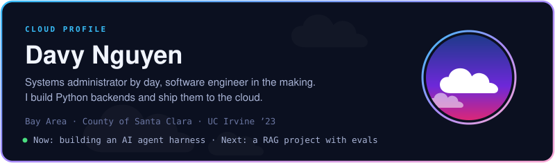
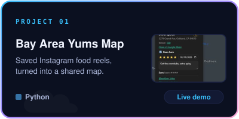
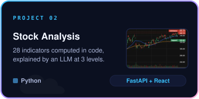
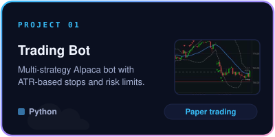
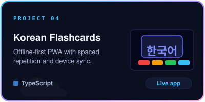
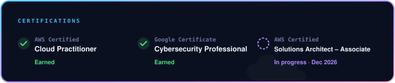

 

 

Try them live: <a href="https://yums-map-demo.fly.dev">Yums Map demo</a> · <a href="https://davyn1.github.io/flashcard-app/">Korean Flashcards</a>

<a href="https://linkedin.com/in/davy-nguyen1">LinkedIn</a> · <a href="https://github.com/davyn1?tab=repositories">All repositories</a>

