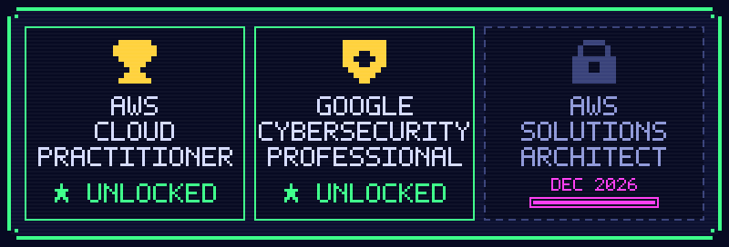
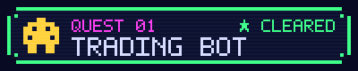
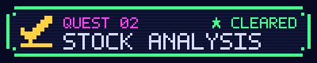
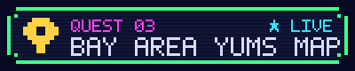
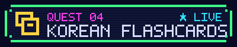
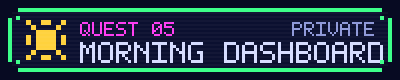
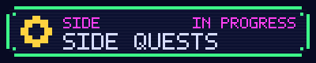

  

## 🧙 Character sheet

By day I keep the County of Santa Clara's systems running: mainframe JCL batch jobs, ServiceNow tickets and server-room monitoring. Off shift I'm leveling up as a software engineer, building Python backends with FastAPI, front ends in React and HTMX, and shipping them to AWS, Docker and Fly.io. B.S. in Business Information Management, UC Irvine (2023).

## 📊 Stats

## 🏆 Achievements

## 📜 Quest log

<table>
  <tr>
    <td width="50%" valign="top">
      
      Multi-strategy paper-trading bot on Alpaca with ATR-based stops, layered risk controls and crash-safe state. 
      <b>Stack:</b> Python · alpaca-py · Streamlit · pytest 
      <a href="https://github.com/davyn1/trading-bot">▶ Repo</a>
    </td>
    <td width="50%" valign="top">
      
      Computes 28 technical indicators in code, then has an LLM explain them at three experience levels without inventing numbers. 
      <b>Stack:</b> FastAPI · React · pandas-ta · Gemini / Claude 
      <a href="https://github.com/davyn1/stock-analysis-app">▶ Repo</a>
    </td>
  </tr>
  <tr>
    <td width="50%" valign="top">
      
      Turns saved Instagram food reels into a shared restaurant map, with an import pipeline that flags messy data for review. 
      <b>Stack:</b> FastAPI · React / TypeScript · SQLite · Docker · Fly.io 
      <a href="https://github.com/davyn1/reel-map">▶ Repo</a> · <a href="https://yums-map-demo.fly.dev">▶ Live demo</a>
    </td>
    <td width="50%" valign="top">
      
      Offline-first PWA for studying Korean with spaced repetition, synced across devices. 
      <b>Stack:</b> React / TypeScript · IndexedDB · FastAPI · Postgres 
      <a href="https://github.com/davyn1/flashcard-app">▶ Repo</a> · <a href="https://davyn1.github.io/flashcard-app/">▶ Live app</a>
    </td>
  </tr>
  <tr>
    <td width="50%" valign="top">
      
      Read-only morning page that pulls priorities, tasks and unread email from Notion and Gmail. 
      <b>Stack:</b> FastAPI · HTMX · Notion API · Gmail API 
      Private repo
    </td>
    <td width="50%" valign="top">
      
      <b>Now:</b> building an AI agent harness. 
      <b>Next:</b> a RAG project with evals. 
      <b>Studying:</b> AWS Solutions Architect – Associate (December 2026).
    </td>
  </tr>
</table>

## 📈 Live stats

  
  
  
  <picture>
    <source media="(prefers-color-scheme: dark)" srcset="https://raw.githubusercontent.com/davyn1/davyn1/output/github-snake-dark.svg">
    
  </picture>

---

  
   
  <a href="https://linkedin.com/in/davy-nguyen1"><b>▶ LinkedIn</b></a> · <a href="https://github.com/davyn1?tab=repositories"><b>▶ All repos</b></a>

