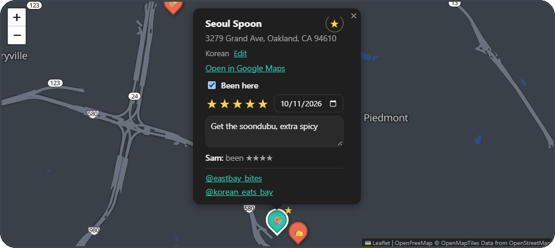
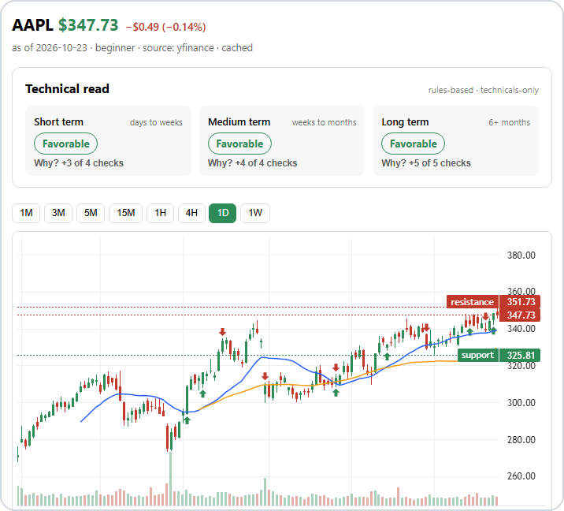
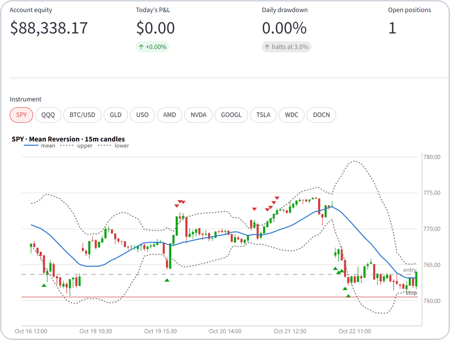

<picture>
  <source media="(prefers-color-scheme: dark)" srcset="assets/banner-dark.svg">
  
</picture>

Systems Administrator Technician at the County of Santa Clara, building backend and cloud projects in Python on the side. Based in the Bay Area.

## Currently

- Building an AI agent harness, then a RAG project with evals
- Studying for the AWS Solutions Architect – Associate exam (December 2026)

## Projects

### [Bay Area Yums Map](https://github.com/davyn1/reel-map) · [Live demo](https://yums-map-demo.fly.dev)

FastAPI + React/TypeScript app that turns saved Instagram food reels into a shared restaurant map. Import pipeline with a review queue for messy data, session auth, 115 pytest tests run by GitHub Actions CI on every push, Docker on Fly.io.

### [Stock Analysis Platform](https://github.com/davyn1/stock-analysis-app)

FastAPI + React app that computes 28 technical indicators locally and uses an LLM (Gemini or Claude) to explain them at three experience levels. Code makes every rating; the LLM only explains it, so it never invents numbers. Daily caching caps LLM calls at 3 per ticker per day.

<picture>
  <source media="(prefers-color-scheme: dark)" srcset="assets/stock-analysis-dark.png">
  
</picture>

### [Trading Bot](https://github.com/davyn1/trading-bot)

Multi-strategy paper-trading bot for the Alpaca API with fault-tolerant order handling, crash-safe state, an honest backtester, and a written postmortem.

<picture>
  <source media="(prefers-color-scheme: dark)" srcset="assets/trading-bot-dark.png">
  
</picture>

### [Korean Flashcards](https://github.com/davyn1/flashcard-app) · [Live app](https://davyn1.github.io/flashcard-app/)

Offline-first PWA for studying Korean with spaced repetition (simplified SM-2), installable to an iPhone home screen. React/TypeScript frontend on IndexedDB syncs decks and progress across devices through a FastAPI + Postgres backend.

## Tech

## Certifications

AWS Certified Cloud Practitioner · Google Cybersecurity Professional Certificate · AWS Solutions Architect – Associate (expected December 2026)

[LinkedIn](https://linkedin.com/in/davy-nguyen1)
